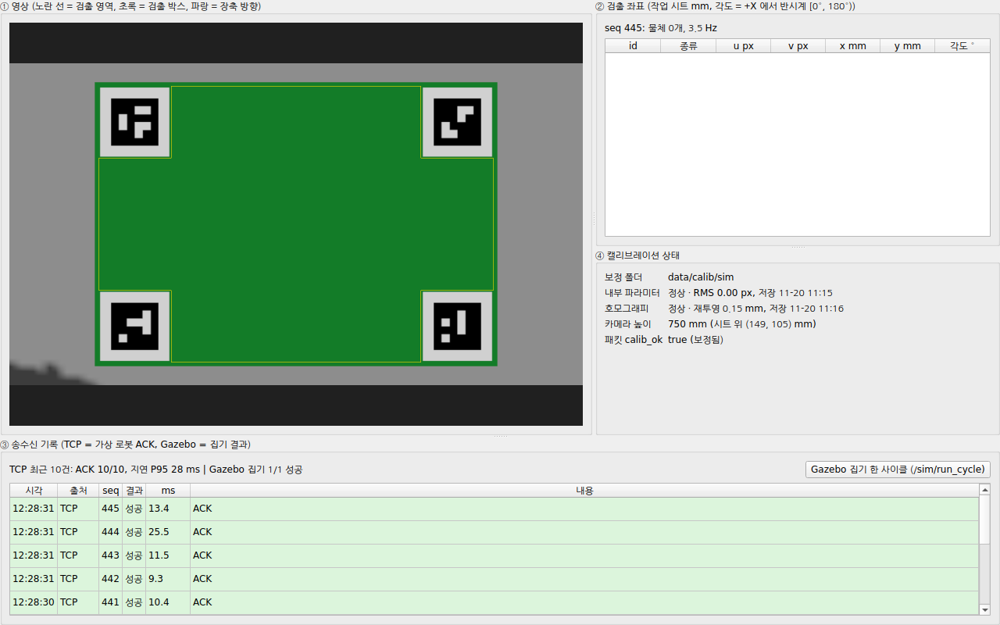

# 2주차 (2026-11-16 ~ 11-20) — 보정 · 통신 · 스폰·흡착 · 집기 사이클 · GUI

실제 작업한 날짜 기준이다. 앞 [WEEK1](WEEK1.md), 뒤 [WEEK3](WEEK3.md). 실행 명령은 [SETUP.md](SETUP.md), 결정 이유는 [DECISIONS.md](DECISIONS.md).
줄이기 전 날짜별 원본 기록은 git `c10d537` 의 `docs/WEEK1~4.md` 에 남아 있다.

## 1. 한눈에: 누가 무엇을 했나

| 팀원 | 한 일 | 결과 |
|---|---|---|
| **동경** (팀원 1) | 카메라 보정, 작업 시트 ROI, 이동 재시도·충돌 물체 등록, 모델 비교(MVTec), **집기 사이클 `/sim/run_cycle`**, Gazebo 가상 카메라·초록 매트, 시차 보정, GUI, KPI 계산 도구, 초록 자세 시트 | 보정 오차 0.26 mm, YOLO F1 0.989(MVTec), 가상 카메라 검출 → 집기 3/3 |
| **성민** (팀원 2) | **TCP 통신** 전체(브리지·서버·ACK·재연결·기록), 세션 연결 런치, 상자 배치(±0.85 m)와 실제 투입 시험, 통신 누락 수정, **놓인 부품을 다시 만들지 않고 집기(existing)** | 3,371/3,371 ACK, 무작위 8회 24개 투입 |
| **가영** (팀원 3) | 아이폰 RTSP 수신, 최신 프레임만 쓰기, WSL 시계 문제 해결, **스폰·진공 흡착 판정·컵 두 개 헤드**, TF·RViz 마커, 실측 정답 수집 도구, 임시 정답 30장 | 31.8 fps, 10 Hz 발행, 흡착 5회 모두 성공 |

## 2. 동경

| 날짜 | 한 일 | 결과 |
|---|---|---|
| 11-16 | 보정을 ChArUco 보드 + ArUco 작업 시트로 전환 | 가상 데이터 시험 통과 |
| 11-16 | 작업 시트 ROI (마커·시트 밖 물체를 검출에서 뺌) | 빈 시트 오검출 0 |
| 11-16 | 지정 좌표 이동 재시도(3회), 상자·바닥 11개를 MoveIt 충돌 물체로 등록, RViz 가 안 뜨던 문제 수정 | 벽 속 목표는 계획 거부 확인 |
| 11-17 | 실제 폰 보정. 왜곡 모델 4가지를 비교해 **왜곡 0** 선택 | 시트 오차 11.96 → 0.71 mm, 최종 **0.26 mm** |
| 11-19 | 모델 비교 A~D (MVTec test 661개) | 규칙 0.747, +SVM 0.804, +CNN 0.795, **YOLOv8n-OBB 0.989** |
| 11-20 | `/sim/run_cycle`: 스폰 → 접근 → 흡착 → 상자 → 안착 확인 | 같은 세 부품 사이클 1/3 → **3/3** |
| 11-20 | Gazebo 가상 카메라·초록 매트·보정, `vision_node` 영상 토픽 입력 | 보정 0.197 mm |
| 11-20 | 시차 보정 (부품 높이만큼 안쪽으로 되돌림) | 가상 카메라 0.30~0.66 → **0.11~0.16 mm**. 실물은 켜면 1.86 → 2.43 mm 라 끔 |
| 11-20 | GUI (영상·좌표·송수신 기록·보정 상태), 실물 배치 자동 반영, Gazebo 전경 | 송신 100/100, P95 21.1 ms (가상 카메라) |
| 11-20 | `evaluate_kpi.py`, 초록 자세 시트 | 임시 정답 위치 1.86 mm, 각도 6.34° |

**모델 비교 (MVTec test 60장)**

| 방식 | 검출 F1 | 종합 F1 (2종) | 각도 오차 | CPU 시간/장 |
|---|---|---|---|---|
| 규칙 (`metal_hsv`) | 0.804 | 0.747 | 5.20° | 23 ms |
| 규칙 + SVM | 0.804 | 0.804 | 5.20° | 39 ms |
| 규칙 + CNN (ResNet18) | 0.804 | 0.795 | 5.20° | 117 ms |
| **YOLOv8n-OBB** | **0.989** | **0.989** | **1.12°** | 98 ms |

분류만 학습해서는 0.80 에서 멈추고, **붙은 부품을 나누는 검출이 병목**이었다 ([DECISIONS 11절](DECISIONS.md)).

**바닥색 비교 (가상 카메라, 정답 8개)**: 흰색은 낮은 조명에서 6/8 + 오검출 8, 회색은 실패 또는 3/8, 검정은 실패, **초록·파랑은 시험한 조명에서 8/8** → 초록 채택 ([DECISIONS 12절](DECISIONS.md)).

GUI 로 찾은 문제: 대기 자세의 로봇 손목을 나사로 검출했다 ([캡처](images/gui_arm_in_view.png)).

## 3. 성민

| 날짜 | 한 일 | 결과 |
|---|---|---|
| 11-16 | TCP 브리지·가상 로봇 서버 (NDJSON 한 줄 + ACK, 재연결, CSV 기록), `--publish-ros` | 실제 이미지 100/100 ACK |
| 11-16 | 시계 튐 감지, 전송 단계 로그, 서버 재시작 시험 | 180초 **3,371/3,371**, 재시작 5회 모두 복구 |
| 11-17 | 상자 위치를 로봇 좌우 ±0.85 m 로, Gazebo·RViz·MoveIt 장면 일치 | 왕복 5회(10번 이동) 모두 첫 시도 성공 |
| 11-17 | 나사·너트를 실제로 상자에 투입 | 나사 0.79 mm, 너트 0.05 mm 오차 (각 1회) |
| 11-17~19 | `team2_link.launch.py`: 스폰 노드와 세션·설정을 대조한 뒤 연결, 중복 실행 거부 | 잘못된 설정은 시작 거부 |
| 11-20 | 통신 누락 수정 (수신과 송신을 분리, 큐 32개) | 같은 조건 11/30 → 30/30 |
| 11-20 | **놓인 부품을 다시 만들지 않고 검출 좌표로 집기** (`existing`) | 무작위 7사이클 21개 + 새 프로세스 1사이클 3개 = **24개 모두 투입** |
| 11-20 | RViz 에 부품·작업 매트·카메라 표시 | — |

- 상자에는 안쪽 높은 경유점을 거쳐 35 mm 안쪽에 놓는다. 충돌 검사는 끄지 않았다.
- 실패도 남겼다: 화면 시연에서 마지막 복귀 계획 실패(11-17), 추가 측정 P95 641.84 ms 로 기준 초과(11-20).
- 자세한 기록: [TEAM2_PROGRESS.md](TEAM2_PROGRESS.md)

## 4. 가영

| 날짜 | 한 일 | 결과 |
|---|---|---|
| 11-16 | 아이폰 RTSP 수신 (USB 개인용 핫스팟), `live_view.py` | 1280×720, 11-17 측정 **31.8 fps** (HTTP 는 7.5 fps) |
| 11-16 | 최신 프레임만 쓰도록 지연 수정 | 밀린 프레임 8장 → 항상 최신 |
| 11-16 | WSL 시계 튐 해결 (`systemd-timesyncd` 끄기) | 4.5 → **10 Hz** |
| 11-17 | 끊김 자동 재접속 (0.5초에서 최대 5초), 카메라 회전 옵션 | 폰 앱을 껐다 켜도 자동 복구 |
| 11-17 | `object_spawner.py`: 패킷대로 부품 생성, 미보정·모르는 종류는 거부, TF·RViz 마커 | 팔이 지나가도 부품 이동 0.0 mm |
| 11-17 | 진공 흡착 판정 `/sim/vacuum` (방향·밀봉·둥근 면·간격·흡착력 다섯 조건) | 150 mm 위에서 켜면 거부 |
| 11-17 | **5 mm 컵(나사) + 센터링 핀 링 컵(너트) 헤드** | 5회 반복: 너트 5/5, 나사 10/10, 놓인 오차 최대 1.5 mm |
| 11-20 | 실제 보정 패킷으로 mm·각도 발행과 스폰 확인 | 패킷과 Gazebo 위치 차이 **0.01 mm 미만** |
| 11-20 | 정답 수집 도구 `collect_ground_truth.py` (자세 30개, 시트가 3 px 움직이면 저장 막음) | 임시 정답 30장: 위치 1.85 mm, 각도 6.34°, 분류 100 % (흰 시트, 화면 안내선) |

세 사람의 환경 점검도 가영 님이 모았다 (폰은 가영 PC 에서만 연결).

## 5. 겪은 문제와 해결

| 문제 | 원인 | 해결 |
|---|---|---|
| 보정했는데 시트 오차 12 mm | 보드 사진이 화면 가운데에 몰림 | 왜곡 모델 비교 → 왜곡 0 |
| 잡은 뒤 들어 올리기·큰 이동 계획 실패 | 같은 위치에 관절 해가 여럿, 팔이 감김 | 수직은 직선, 큰 이동은 현재 관절에서 가까운 관절 목표 |
| 로봇 손목을 나사로 검출 | 대기 자세가 카메라를 가림 | 대기 자세를 매트 옆으로 |
| 가상 카메라에서 마커 0개 | 초록 바탕의 흰 여백이 좁음 (4 mm) | 8 mm 로 |
| 15 cm 위에서도 부품이 붙음 | 고정 관절은 거리를 따지지 않음 | 진공 다섯 조건 |
| 너트가 안 잡힘 | 가운데 8 mm 구멍 | 2 mm 컵은 여유 ±0.25 mm 라 버리고 링 컵 채택 |
| 처음 쓰는 부품이 수 m 날아감 | 슬롯을 처음 쓸 때 자동으로 붙음 | 시작 자세에서 모든 슬롯을 한 번 썼다 지움 |
| 수집 중 시트가 네 번 움직임 | 고정 전 작업 | 테이프로 고정, 이동 감지 추가 |

## 6. 함께 정한 것

- 검출 모델 비교는 동경이 맡고, 쓸지는 셋이 정한다 (11-19).
- Gazebo 안에 위에서 보는 카메라를 두고 초록 바닥을 쓴다 (11-20 회의).
- 실물 모드(`respawn`)의 집기 성공은 성공률로 쓰지 않고, 놓인 부품 집기(`existing`)만 쓴다.
