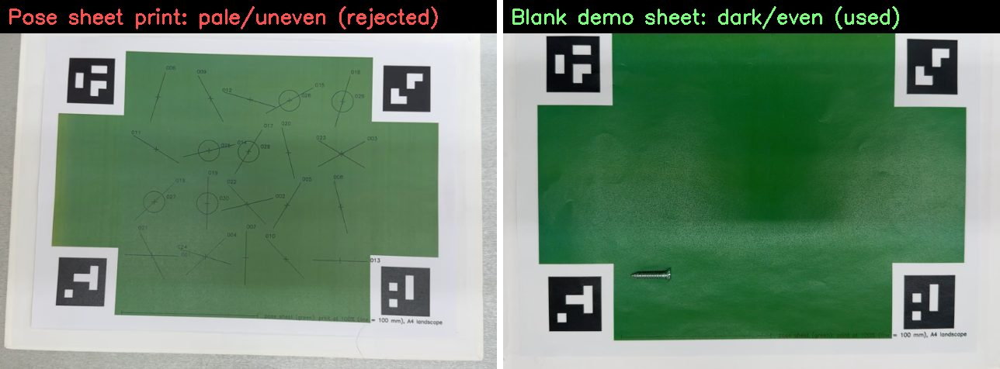
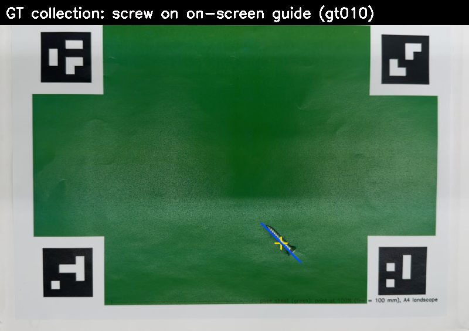
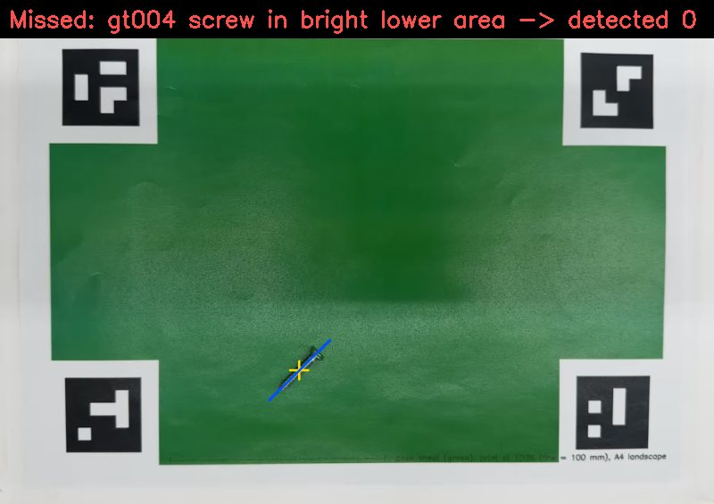
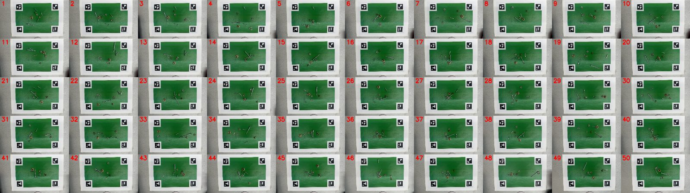

# 3주차 (2026-11-23 ~ 11-25) — 10개 집기 · 재학습 YOLO · 공식 KPI · 시연 준비

실제 작업한 날짜 기준이다. 앞 [WEEK1](WEEK1.md) · [WEEK2](WEEK2.md). 실행 명령은 [SETUP.md](SETUP.md), 결정 이유는 [DECISIONS.md](DECISIONS.md), 요약은 [PORTFOLIO.md](PORTFOLIO.md).
줄이기 전 날짜별 원본 기록은 git `c10d537` 의 `docs/WEEK1~4.md` 에 남아 있다.

## 1. 한눈에: 누가 무엇을 했나

| 팀원 | 한 일 | 결과 |
|---|---|---|
| **동경** (팀원 1) | 라벨 도구, **YOLO 재학습**과 비교, ROS 적용(ONNX), GUI 다듬기와 [처음부터 다시], 전체 실행 `run_demo.sh`, 폰 측정 `measure_phone_kpi.sh`, KPI 분석 | test 56개 중 규칙 17 → **YOLO 55** |
| **성민** (팀원 2) | **10개 슬롯·큰 상자·나사산 모델**, 반복 시험, 종료 오류 정리, 나사 길이·머리 방향 반영, 붙은 부품 재현 | 20/20, **27/27** 투입, 붙은 부품 8/8 의 바탕 |
| **가영** (팀원 3) | 초록 시트, 정답 30장 두 번, 학습 사진 50장, 시연 리허설, **공식 KPI 정답과 폰 송신 측정** | 리허설 18/18, **폰 송신 100/100** |

### 공식 KPI (11-25, 인쇄 선 정답 30장·실물 폰, 측정 가영)

| 지표 | 기준 | 규칙 | 재학습 YOLO |
|---|---|---|---|
| 위치 오차 (필수) | ≤ 2 mm | **1.88 mm 달성** | **1.99 mm 달성** |
| 각도 오차 (필수) | ≤ 3° | 4.41° **미달** | 3.15° **미달** |
| 폰 송신 100회 (필수) | 100 % | **100/100 달성** | **100/100 달성** |
| 검출 → 송신 P95 (필수) | ≤ 300 ms | **16.1 ms 달성** | **85.5 ms 달성** |
| 분류 (선택) | ≥ 95 % | 93.3 % 미달 (2장 놓침) | **100 % 달성** |
| Pick (선택) | ≥ 90 % (20개 이상) | 가상 카메라 20/20, 27/27 (성민). 제한된 배치 | |

조건과 한계는 [PORTFOLIO 8.4](PORTFOLIO.md). 11-24 화면 안내선 정답(규칙 1.99 mm·3.72°, YOLO 1.55 mm·2.29°)은 보정에 기대는 정답이라 **참고용**이다.

## 2. 동경

| 날짜 | 한 일 | 결과 |
|---|---|---|
| 11-24 | 라벨 도구 `gui/label_obb.py` (자동 초안 → 사람 확인) | 50장, 나사 250·너트 150, 122개 수정 |
| 11-24 | 재학습·비교 `finetune_obb.py` (시작 2종 × 10·20·36장, 갱신 횟수 같게, test 는 한 번) | 아래 표 |
| 11-24 | 규칙+SVM 을 우리 사진에서 비교 `compare_svm.py` | 18/56. 분류가 아니라 검출이 병목 |
| 11-24 | `vision_node` YOLO 선택 옵션 (ONNX 를 OpenCV 로, 기본은 규칙) | 10 Hz, P95 79 ms (Gazebo 없이). Gazebo 와 같이 켜면 5.1~5.4 Hz |
| 11-24 | 나사·너트가 아닌 물체 거르기 `part_check.py` | 기본 꺼짐 (기준값용 사진 부족) |
| 11-24 | GUI: 쉬운 말, [처음부터 다시], 검출 방식 배지, 화면 정리. 성민 님 시연 GUI 가 바로 꺼지던 오류 수정 | 떨어진 5개 5/5 → 다시 → 5/5 |
| 11-24 | `scripts/run_demo.sh` (yolo·rule·sim·stop), 붙은 부품 재시험 | 붙은 8개 1/8 → **8/8** (1회) |
| 11-25 | `scripts/measure_phone_kpi.sh`, 크게 틀린 두 장 분석, 문서·발표 자료 | 아래 4절 |

**재학습 결과 (초록 시트 test 7장, 부품 56개)**

| 방식 | 맞힘 | 놓침 | 오검출 | 사진 한 장 |
|---|---|---|---|---|
| 규칙 | 17 | 37 | 13 | 9~15 ms |
| 규칙 + SVM (우리 사진 학습) | 18 | 37 | 13 | 11 ms |
| YOLO 재학습 전 (MVTec) | 30 | 26 | 33 | 48 ms |
| **YOLO 재학습 (확정 `mvtec_n36_s0`, 신뢰도 0.30)** | **55** | **1** | **0** | 53 ms |

- 이득은 붙은 부품에서 나온다: 떨어진 부품 12/14 → 14/14, 가깝거나 겹친 부품 **5/42 → 41/42**.
- MVTec 시작과 DOTA 시작의 차이는 없었고, 10장으로도 52~53개였다.
- 한계: 같은 부품 8개·같은 시트·조명, 약 7분 30초 동안 찍은 사진이다. 다른 조건은 모른다. 너트 상자의 각도는 쓰지 않는다(`null`).

## 3. 성민

| 날짜 | 한 일 | 결과 |
|---|---|---|
| 11-23 | 슬롯 10개, 상자 22 cm, 나사산·육각 머리·구멍 너트 모델, 조명·색·카메라 높이 무작위화 | 10개씩 2회 **20/20** |
| 11-23 | 반복 시험 (9개씩 3회, 한 번은 위치 ±4 mm) | **27/27**. 154.5 / 158.3 / 126.9초 |
| 11-23 | 통신 100개씩 6회 | 600/600, P95 최대 297.74 ms |
| 11-23~24 | 응답만 사라진 생성 요청을 실제 장면으로 확인, 종료 순서를 바로잡은 전용 실행기(`team2_move_group`, Gazebo·RViz 관리자), 팔 그림자 오검출 제거 | 정상 종료, 강제 종료 0 (시험한 조건) |
| 11-24 | 나사 길이를 검출에서 추정해 Gazebo 모델에 반영, 머리 방향 추정, 부품끼리 충돌하지 않게 분리 | 겹친 배치를 그대로 재현 |
| 11-25 | 스폰 부품을 회색 금속으로 | — |

- **9개를 150초 안에**: 여섯 번 모두 9/9 투입, 시간은 여섯 번 중 세 번 달성 (가영 님 리허설 두 번 포함). Gazebo·RViz 창까지 켠 조건은 196.1초.
- 부품끼리 부딪히지 않게 한 결과라, 실제 로봇이 붙은 부품을 집는다는 뜻이 아니다. 가려진 머리는 방향을 "모름" 으로 둔다.
- 자세한 기록: [TEAM2_PROGRESS.md](TEAM2_PROGRESS.md)

## 4. 가영

| 날짜 | 한 일 | 결과 |
|---|---|---|
| 11-23 | 초록 자세 시트 생성·확인, 스폰의 "없는 모델" 오류 메시지 제거, 담당 전체 점검 | 테스트 204개 |
| 11-24 | 성민 님 코드 받은 뒤 재점검 | 220개, 스폰·흡착 통과 |
| 11-24 | 시연 리허설 (`run_team2_demo.py`, 9개 2회) | **18/18** (148.0 / 135.3초), 정상 종료 |
| 11-24 | 정답 30장 (화면 안내선, 진한 빈 초록 시트) | 규칙 1.99 mm·3.72°·93.3 % |
| 11-24 | 재학습용 사진 50장 촬영, 대표 사진 4장 | 사진마다 부품 8개(나사 5·너트 3), 매번 새로 배치 |
| 11-24 | 붙은 부품을 못 집는 원인 계산 | 나사를 모두 40 mm 로 만들어 −7.1 mm 파고듦 |
| 11-25 | **정답 30장 (인쇄 선, 공식 KPI)** | 1절 표. 보정 오차 0.270 mm |
| 11-25 | **실물 폰 100회 송신** (Gazebo 끔, 부품 9개) | 두 방식 모두 100/100. 첫 측정은 부품이 화면에 없어 무효, 다시 한 번 잼 |

- 시트 테이프 반사를 규칙·YOLO 둘 다 나사로 잡아 테이프를 고쳤다. 그 뒤 부품 8개에서 YOLO 8/8, 규칙 6/8, 오검출 0.
- 인쇄 시트 오른쪽 아래가 빛에 바래 규칙이 그 자리를 나사로 잘못 잡는다.
- 크게 틀린 두 장(gt003, gt013)은 빼지 않았다. 동경이 사진으로 확인: 나사가 정답 선에서 약 4~5°, 7~8° 비뚤게 놓였고 YOLO 도 5~6°, 2~3° 더 틀렸다.
- 시차 보정을 켜면 규칙 2.31, YOLO 2.14 mm 로 커져 실물은 끈다.

| 사진 | 내용 |
|---|---|
|  | 연하게 인쇄된 자세 시트(11-24 사용 안 함)와 진한 빈 시트 |
|  | 정답 수집 화면 (11-24 안내선 방식) |
|  | 규칙이 놓친 나사 (gt004) |
|  | 재학습용 사진 50장 |

## 5. 겪은 문제와 해결

| 문제 | 원인 | 해결 |
|---|---|---|
| 초록 시트에서도 그림자를 부품에 넣음 | 규칙의 "어두움" 기준 (추정) | 우리 사진으로 YOLO 재학습 |
| ROS 에서 YOLO 를 못 돌림 | OpenCV 4.6 이 변환 모델의 끝부분 오류 | 신경망만 ONNX 로 자르고 상자는 NumPy |
| 붙은 부품 8개에서 1개만 집음 | 나사가 모두 40 mm 라 겹쳐 튕김 | 검출 길이 반영 + 부품끼리 충돌 분리 → 8/8 |
| PC 한 대에서 느림 | Gazebo 를 CPU 로 그림 | 창 없이 실행, 송신 KPI 는 Gazebo 끄고 측정 |
| 시연 GUI 가 바로 꺼짐 | GUI 구조를 바꾼 뒤 연결이 깨짐 | 고치고 실제로 켜 보는 시험 추가 |

## 6. 함께 정한 것과 남은 것

| 항목 | 상태 |
|---|---|
| 공식 KPI 정답 | 인쇄 선 30장 (11-25 결정) |
| 시연 검출 방식 (규칙 / YOLO) | 정해야 함 |
| 실물 로봇·실제 진공 장치 시험 | 하지 않음 |
| 다른 조명·새 부품·빈 시트·기타 물체 사진 | 발표 이후 |

최종 자동 테스트: **301개 통과** (`vision_pick_place` 203, `ur5e_pick_place` 98, 11-25).
