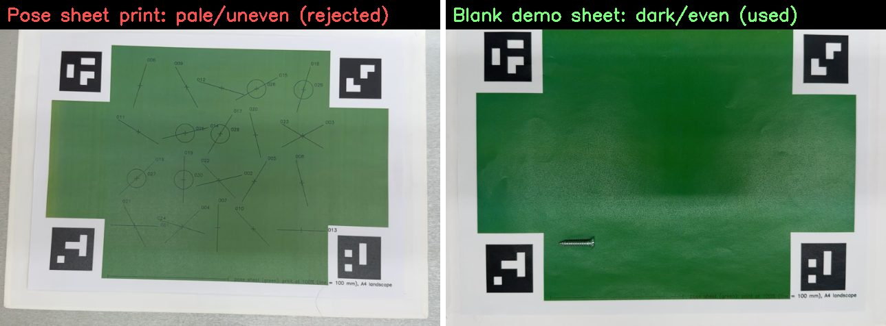
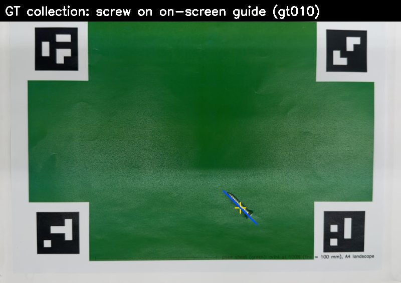
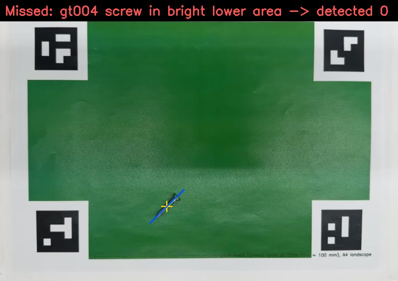
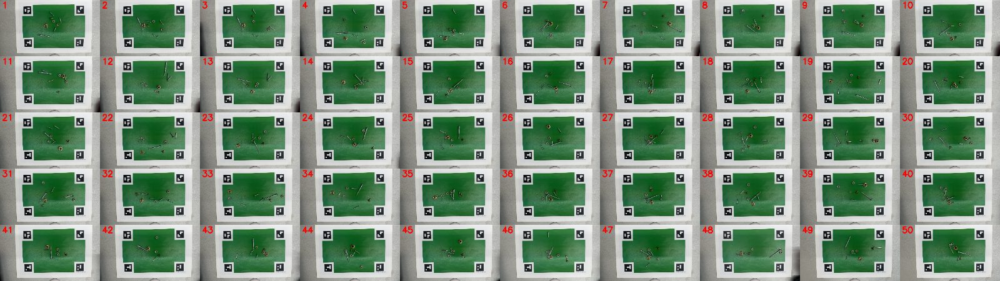

# 4주차 — KPI · Pick & Place 통합 · 실측 정답·시연

문서 구성: **1. 현황 요약 → 2. 실행 방법 → 3~5. 팀원별 기록** (WEEK3.md 와 같은 틀).
팀원 1·2 절은 각자 채운다. 이 파일은 2026-11-20 팀원 3 이 처음 만들었다.

## 1. 현황 요약 (2026-11-20)

| 팀원 | 4주차 담당 (PROJECT.md 2.3) | 상태 | 남은 일 |
|---|---|---|---|
| 팀원 1 (동경) | KPI: `evaluate_kpi.py`, 100회 송신 테스트 + 모델 비교 | 🟡 `evaluate_kpi.py` 완성 (11-20). 초록 시트 정답 30장 (11-24): 규칙 1.99 mm · 3.72° · 93.3 %, YOLO 1.55 mm · 2.29° · 100 %. 초록 시트 50장으로 YOLO 재학습, `vision_node` 선택 옵션 (기본은 규칙) | 실물 폰 입력 100회 송신·P95, 공식 KPI·시연 방식 결정(셋이), 추가 촬영(다른 조명·새 부품·빈 시트·기타 물체) |
| 팀원 2 (성민) | Pick & Place 한 사이클 통합 (`pick_place_node`) | 11/23: 10개 확장, 기존 물체 20/20, 외형 개선 9/9·123.17초 | 종료 native 오류 등 제한은 TEAM2_PROGRESS 참고 |
| 팀원 3 (가영) | 실측 정답 30+ 자세 수집, 시연 준비 | 🟡 임시 정답(화면 안내선 방식) 30장 수집·평가 (위치 MAE 1.85 mm, 각도 6.34°, 분류 100%). 인쇄 시트 PDF 준비. **최종 정답은 초록 시트로 결정** (11-23), `pose_sheet_green.pdf` 생성 | 초록 시트 인쇄·채도 확인 후 최종 정답 수집, 시연 준비 |

## 2. 실행 방법

### 실측 정답 수집 (팀원 3, `scripts/collect_ground_truth.py`)

```bash
# 자세 목록 (30개: 나사 24 = 0~165° 15° 간격 ×2, 너트 6, 위치는 모두 10 mm 격자점)
python3 scripts/collect_ground_truth.py --print-plan

# 최종용 인쇄 시트 (A4 가로, 100% 배율로 인쇄, 아래 100 mm 선을 자로 확인)
python3 scripts/collect_ground_truth.py --print-sheet data/ground_truth/pose_sheet.pdf

# 수집: print = 인쇄 시트 선 위에 놓음 (최종), overlay = 화면 안내선에 맞춤 (임시)
python3 scripts/collect_ground_truth.py --rotate 270 --method print
```

- 시트를 바꾸거나 움직이면 먼저 시트 사진을 다시 찍고 `compute_homography.py --aruco` 로 homography 를 새로 만든다.
- 화면: 노란 십자 = 목표 중심, 파란 선 = 나사 장축 방향, 노란 원 = 너트. `s` 저장, `n`/`p` 다음/이전, `q` 종료 (다시 실행하면 이어서).
- 시트 마커가 homography 예상 위치에서 3 px 넘게 벗어나면 화면에 `SHEET MOVED` 가 뜨고 저장이 막힌다.
- 일부만 다시 찍기: `--only gt002,gt013 --out-dir data/ground_truth/<새 폴더>` (기존 폴더를 덮어쓰지 않게 새 폴더로).
- **시트는 네 귀퉁이를 테이프로 고정한 뒤 시작한다.** 11-20 에는 고정 전 시트가 네 번 움직여 homography 를 매번 다시 만들었다.
- 예측값·오차는 수집 중에 보여 주지 않는다 (보면서 놓으면 정답이 예측 쪽으로 오염됨).
- 출력 `data/ground_truth/<method>_<날짜>/`: `poses.csv` (PROJECT.md 6.1 형식 `sample_id,image,x_mm,y_mm,angle_deg,part_type`), `images/`, 저장 순간 검출 결과 `preds.csv`.
- 폰이 세로로 보내는 동안은 `--rotate 270` (노드도 `-p camera_rotate_deg:=270`). `params.yaml` 은 0 그대로.

## 3. 팀원 1 (동경) 기록

### 2026-11-20 KPI 계산 `scripts/evaluate_kpi.py` (계산은 `vision_pick_place/kpi.py`)

```bash
# 정답 사진으로 위치·각도·분류 (vision_node 와 같은 처리, 시차 보정 끈 값·켠 값 둘 다) + 송신 + Gazebo 집기
PYTHONPATH=src/vision_pick_place python scripts/evaluate_kpi.py \
    --truth data/ground_truth/<폴더>/poses.csv --per-image-homography \
    --comm logs/comm_<날짜>_*.csv --pick "logs/sim_pick_*.csv" --out logs/kpi_<날짜>.json
```

- 위치·각도: 사진마다 같은 처리로 검출 → 정답 위치에서 15 mm 안의 가장 가까운 검출과 대응 (없으면 미검출, 분류에서는 틀린 것으로 셈).
  `--per-image-homography` 는 사진마다 시트 마커로 호모그래피를 다시 구한다 (촬영 중 시트가 움직였을 때). `--preds` 로 저장된 검출을 쓸 수도 있다.
- 송신: `logs/comm_*.csv` 의 처음 100회 시도 중 ACK 비율, ACK 받은 것 중 시계 튐 없는 지연의 P95.
- Pick: `logs/sim_pick_*.csv` 의 물체별 결과. 결과마다 기준 대비 달성/미달과 측정 장비를 같이 출력.
- 테스트 8개 (`test_kpi.py`, 손으로 계산한 작은 예).

**임시 정답 30장 + 오늘 로그로 실행한 결과 (최종 KPI 아님):**

| 지표 | 기준 | 시차 보정 끔 | 시차 보정 켬 |
|---|---|---|---|
| 위치 MAE | ≤ 2 mm | 1.86 mm | 2.43 mm |
| 각도 MAE | ≤ 3° | 6.34° | 6.34° |
| 분류 정확도 | ≥ 95 % | 100 % | 100 % |
| 송신 성공률 (가상 카메라 입력 100회) | 100 % | 100 % | |
| 검출→송신 P95 (가상 카메라 입력) | ≤ 300 ms | 28.6 ms | |
| Pick 성공률 (11-20 개발 중 로그 전체 38개) | ≥ 90 % | 89.5 % (34/38) | |

- 위치·각도는 가영 님 평가를 재현했다. 시차 보정 해석은 WEEK3 동경 11-20 "실물 정답 30장" 참고 (정답에도 시차가 들어 있어 이 데이터로는 판단 불가).
- Pick 은 오늘 고치기 전 실패까지 다 섞인 값이다. 최종은 수정 후 반복 시험만 따로 모아 잰다.
- 송신은 가상 카메라 입력이다. 공식 값은 실물 폰 입력으로 다시 잰다.


### 2026-11-20 초록 자세 시트 (그림자 대책, 다음 주 재촬영용)

흰 시트에서는 은색 나사 옆 그림자를 같이 검출해 위치가 한쪽으로 치우쳤다 (WEEK3 동경 11-20, x −1.26 mm). 가상 카메라 바닥색 비교처럼
초록 바탕 + `metal_hsv` 면 그림자가 빠진다. 가영 님 자세 시트에 `--green` 옵션을 추가했다 (흰 시트는 그대로).

```bash
PYTHONPATH=src/vision_pick_place python3 scripts/collect_ground_truth.py --print-sheet data/ground_truth/pose_sheet_green.pdf --green
# 검출은 params.yaml 위에 params_green.yaml 을 겹쳐 쓴다 (metal_hsv, 마커 여백 9 mm, 가장자리 여백 8 mm)
ros2 run vision_pick_place vision_node --ros-args --params-file src/vision_pick_place/config/params.yaml \
    --params-file src/vision_pick_place/config/params_green.yaml
# 수집·평가 스크립트도 --params 에 두 파일을 순서대로 (뒤 파일이 덮음)
G="src/vision_pick_place/config/params.yaml src/vision_pick_place/config/params_green.yaml"
python3 scripts/collect_ground_truth.py --rotate 270 --method print --params $G
PYTHONPATH=src/vision_pick_place python scripts/evaluate_kpi.py --truth data/ground_truth/<폴더>/poses.csv --params $G
```
초록 설정은 초록 시트 전용이다. 흰 시트 사진에 쓰면 흰 바탕 전체가 '채도 낮음' 으로 한 덩어리가 되어 검출이 안 된다.

| 흰 시트와 다른 점 | 이유 |
|---|---|
| 마커 둘레 흰 여백 4 → 8 mm | 초록 바탕에서는 흰 여백 테두리도 사각형으로 보여, 4 mm 면 ArUco 가 마커를 버린다 (Gazebo 에서 0개 검출 확인) |
| 자세 선·번호·100 mm 선을 진한 초록 | 회색 선은 채도가 낮아 metal_hsv 에서 부품으로 잡힌다 |
| 초록은 가장자리 6 mm 안쪽부터, 10 mm 격자 없음 | 프린터가 가장자리를 못 칠해 흰 띠가 남는다 → 검출 영역에서 8 mm 를 뺀다 |

확인 (PNG 를 카메라 배율 2.6·3.0 px/mm 로 줄여서): PDF 297.0 × 210.0 mm, 마커 4/4 (보정 RMS 0.05~0.07 mm), 초록 설정 오검출 0개 (흰 시트 설정이면 1개).
남은 확인: 실제 인쇄본의 초록 색·조명에서 `hsv_max_saturation` (70) 이 맞는지 폰으로 한 장 찍어 본다. 인쇄 초록이 연하면 채도가 낮아질 수 있다.

### 2026-11-20 GUI 에 Gazebo 전경, Gazebo 창 없이 시연 (FPS)

- `workcell.sdf` 에 시연용 **전경 카메라** (`overview_camera`, 960×540, 5 Hz): 로봇 앞 오른쪽 위 3/4 시점에서 로봇·작업 매트·상자 두 개를 한 화면에.
  후보 6곳을 Gazebo 에서 실시간으로 옮겨 보고 골랐다. GUI ① 에 [검출 카메라] / [Gazebo 전경] 탭 (11-10 목업의 Gazebo 판을 GUI 안으로).
- 이제 Gazebo 창·RViz 를 띄우지 않아도 집기 과정을 볼 수 있다. WSL2 에서 Gazebo 창 렌더링이 가장 무거워서 끄면 빨라진다:

| | Gazebo 창 + RViz | 둘 다 끔 |
|---|---|---|
| 검출 결과 주기 (실제 처리) | 3.0 Hz | **4.1 Hz** (상한 5 Hz) |
| CPU 유휴 | 26 % | **43 %** |

```bash
SIM_ARGS="gazebo_gui:=false launch_rviz:=false" logs/start_demo.sh   # 권장
```
- GUI ③ 콘솔의 ACK 는 1초마다 한 줄로 묶는다 (`ACK  seq 120~124  5건, 평균 14 ms`). 물체가 없어도 계속 송신·ACK 되므로 한 줄씩 쓰면 집기 결과가 밀려 올라갔다. ERR·SIM 이 오면 모아 둔 ACK 를 먼저 써서 순서를 지킨다.
- 안 보이는 탭의 영상은 변환하지 않는다 (CPU 절약).

### 2026-11-20 시연 구성: 왼쪽 실물 카메라 · 오른쪽 Gazebo, 실물 배치 자동 반영

11-10 목업의 두 판(GUI 대시보드 + Gazebo 창)을 한 창에 넣었다. 위 두 칸이 크게, 아래 ② 좌표 ③ 송수신 ④ 캘리브.

| 위치 | 내용 |
|---|---|
| 왼쪽 ① | **실물 휴대폰 카메라** + 검출 박스 (`/vision/debug_image`) |
| 오른쪽 ⑤ | **Gazebo 시연** 전경 카메라 (`/sim/overview/image`), 반영 상태 한 줄 |

**실물 → Gazebo 자동 반영** (헤더 체크박스, 실물 모드 기본 켬): 작업 시트 위 배치가 4패킷(약 1초) 동안 3 mm 안에서 그대로면
`/sim/spawn_objects` 로 같은 위치에 가상 부품을 만든다. 손이 들어와 흔들리는 동안은 반영하지 않고, 이미 반영한 배치에서 5 mm 넘게 바뀌어야 다시 반영한다.
다 치우면 `/sim/clear_objects`. 사이클 중에는 멈추고, 사이클 뒤 실물이 그대로면 다시 만들지 않는다. 그다음 [사이클 실행] 으로 집는다.

```bash
logs/start_demo.sh                                   # 실물: 휴대폰 (params.yaml 의 camera_url)
VISION_ARGS="-p camera_rotate_deg:=270" logs/start_demo.sh   # 폰이 세로로 보낼 때
MODE=sim logs/start_demo.sh                          # 가상 카메라 입력 ([부품 놓기 (무작위)])
IMAGE_DIR=<사진 폴더> CALIB_DIR=<보정 폴더> logs/start_demo.sh   # 폰 없이 사진으로 시험
```

확인 (폰 대신 가영 님 실물 사진, 그 사진으로 만든 보정 `data/calib/test_real`):
- 너트 사진 → Gazebo 에 너트 (0.468, −0.027) m = 시트 (168.9, 123.6) mm 와 일치.
- 사진을 나사 사진으로 바꿈 → 이전 부품을 지우고 나사 (0.528, 0.011) m, 19.4° 로 다시 스폰 (검출 (227.8, 161.0) mm).
- [사이클 실행] → 나사 1/1 상자 투입.
- 남은 것: 실제 폰 영상으로 같은 흐름 (손으로 놓는 동안 반영 안 되는지), 전경 화면에서 부품이 작게 보임 (40 mm 나사).

### 2026-11-20 GUI 위 칸 3개, 부품 모양, 부품 슬롯 길들이기

- **GUI (실물 모드)**: 위 칸을 ① 실물 카메라 · ⑤ Gazebo 전경 · ⑥ **Gazebo 위 카메라** (`/sim/camera/image` 원본) 3개로. ① 과 ⑥ 을 나란히 보면 실물 배치가 같은 자리로 반영됐는지 바로 보인다. 가상 모드에서는 ① 이 이미 Gazebo 위 카메라라 ⑥ 은 숨긴다.
- **부품 모양**: 나사는 원기둥만 있어 분필처럼 보였다. 11-20 에 머리·육각 메시를 만들었으나, 성민 님 11-23 프로필(나사산·육각 머리·구멍 너트, `team2_demo_profile.py`)과 겹쳐 11-24 에 원본 모델로 되돌리고 성민 님 모델을 쓴다.
  가상 카메라 검출: 6개 모두 종류 맞음, 너트 중심 0.5 mm 안, 나사 중심은 머리 쪽으로 약 2 mm·각도 1~2° (머리 때문에 윤곽이 한쪽으로 치우침, 실물 나사와 같은 현상).
- **부품이 수 m 날아감**: 슬롯(obj_0~2)을 처음 쓸 때 DetachableJoint 가 부품을 패드에 자동으로 붙였다 떼는데, 로봇이 대기 자세(매트 옆)에 있을 때 그러면 나사 2개가 (3.9, 1.3), (−0.8, 6.6) m 로 날아갔다. 두 번째부터는 제자리.
  → `start_demo.sh` 가 띄운 직후(로봇 시작 자세) 모든 슬롯을 한 번 놓고 지운다 (`/sim/warmup_slots`, `max_objects` 개).

### 2026-11-24 성민 님 10슬롯과 합치기

- 동경이 따로 늘린 슬롯 10개(`ur5e_vacuum.urdf.xacro`, `sim.yaml`)는 `team2_ten_slots.urdf.xacro` 와 겹쳐 `obj_3`~`obj_9` 플러그인이 2개씩 생겼다 → 되돌리고 성민 님 10슬롯·22 cm 상자를 쓴다.
- `start_demo.sh` (로컬)가 `make_team2_demo_profile.py --realistic` 으로 프로필을 만들어 넘긴다. 집기 방식은 가상 모드 `existing`, 실물 모드 `respawn` (`SCENE=` 로 바꿈).

| 확인 (headless, GUI offscreen) | 결과 |
|---|---|
| 전체 테스트 | 222개 통과 (성민 님 `0d8c130` 까지 받은 뒤), 슬롯 플러그인 `obj_0`~`obj_9` 각 1개 |
| 가상 모드 `existing`, 무작위 3개 | 3/3 투입 (`f9daf64`, `0d8c130` 에서 각 1회) |
| 실물 모드 `respawn`, 폰 대신 사진 gt015 (나사), 사진에 맞는 보정 | 검출 (227.9, 161.0) mm 19.5° / 임시 정답 (229.6, 162.1) mm 28.6°, 1/1 투입 (`f9daf64`, `0d8c130` 에서 각 1회) |
| 같은 사진, 다른 날의 보정 (시험 실수) | **마커를 나사로 검출했는데도 1/1 투입.** `respawn` 은 검출 위치에 부품을 새로 만들어 집으므로 검출이 틀려도 성공으로 나온다 → Pick 성공률 근거로 쓰지 않는다 |

남은 확인: 폰을 연결한 실물 모드, 실물 모드 `existing`, 부품 10개 사이클.

### 2026-11-24 재학습용 라벨 도구 `gui/label_obb.py` (계산은 `obb_labels.py`)

규칙 검출로 초안 회전 상자를 만들고 사람이 고친 뒤 YOLO-OBB 학습 데이터로 내보낸다. 클래스는 나사·너트 2종.

```bash
source env.sh
python3 scripts/live_view.py rtsp://172.20.10.1:8554/live data/captures/green/train   # 촬영 (val, test 도 폴더만 바꿔서)
python3 -m vision_pick_place.gui.label_obb data/captures/green                         # 라벨
python3 -m vision_pick_place.gui.label_obb data/captures/green --status                # 진행 상황
python3 -m vision_pick_place.gui.label_obb data/captures/green --export data/models/green_yolo_obb
```

- **확인 완료([Enter])가 아닌 사진이 하나라도 있으면 내보내지 않는다.** 초안이 정답으로 섞이거나 빠뜨린 부품이 배경으로 학습되는 것을 막는다. 고치면 다시 확인 전이 된다. 같은 파일이 두 폴더에 있어도 막는다.
- 나사·너트가 아닌 물체는 라벨하지 않는다. 상자 0개로 확인한 사진은 배경 사진으로 내보낸다.
- 초안 영역은 사진 속 마커로 구하므로 보정 파일이 필요 없다. 초안은 기본이 초록 시트용(`--draft local`), 흰 시트는 `--draft rule --params src/vision_pick_place/config/params.yaml`.
- 확인: 단위·창 테스트 13개, 흰 시트 사진 8장 사본에서 초안 8/8개(사진당 나사 1개), 내보낸 데이터로 YOLO 1 epoch 실행(형식 확인용, 성능 아님). 초록 실물 사진과 사람이 직접 쓰는 확인은 아직이다.
- 붙은 부품은 한 상자로 나오므로 지우고 새로 그린다.

**초록 시트 초안을 바꾼 이유 (가영 님 학습 사진 50장).** `metal_hsv` 는 초록 위 그림자를 "어두움"(`hsv_max_dark_value` 70)으로 부품에 넣었다. 11-24 정답 30장에서 검출 전경 중 "어두운 초록" 이 나사 평균 51 %, 너트 37 % 였다 (나사산 사이 어두운 부분도 일부 포함). 어두움 기준만 낮추면 금색 부품을 놓친다. 그래서 초안은 **주변 바탕보다 초록 비율 G/(R+G+B) 가 낮은 곳**을 쓴다 (`local_green_mask`, 바탕은 위치마다 중앙값).
"초록 바탕이면 그림자가 빠진다"(11-20)는 Gazebo 화면에서만 확인한 것이었고 실물에서는 맞지 않았다. `vision_node` 설정은 아직 바꾸지 않았다.

| 라벨 (50장) | 내용 |
|---|---|
| 나눔 | 촬영 순서대로 train 36 / val 7 / test 7 (이웃 사진은 부품 일부가 제자리에 남아 있어 무작위로 섞지 않음) |
| 개수 | 50장 모두 나사 5 · 너트 3 = 나사 250, 너트 150 |
| 고침 | 동경이 확인한 뒤 나사 상자 122개를 다시 고침: 머리·끝이 잘림 74개, 몸통과 기울기가 다름 48개 (초안이 최소 사각형이라 머리가 큰 나사에서 10~20° 기울었음). 전체를 동경이 다시 확인 |
| 한계 | 같은 부품 8개·같은 날·같은 조명. 빈 시트, 기타 물체, 처음 보는 부품(`test_new`) 사진은 없다. 초안 값은 50장 전체를 보고 정해서, 이 초안 방식을 검출기로 쓰면 val·test 점수는 깨끗한 시험이 아니다 |

### 2026-11-24 재학습·비교 스크립트 `scripts/finetune_obb.py` (채점은 `obb_eval.py`)

```bash
P=.venv-ml/bin/python; D=data/models/green_yolo_obb        # label_obb --export 한 폴더
$P scripts/finetune_obb.py train    --data $D --dry-run    # 계획·예상 시간
$P scripts/finetune_obb.py train    --data $D              # MVTec 시작·DOTA 시작 × 사진 10·20·40장
$P scripts/finetune_obb.py evaluate --data $D --draw       # 검증 사진 비교 (설정을 고를 때)
$P scripts/finetune_obb.py evaluate --data $D --split test --draw       # 마지막에 한 번
$P scripts/finetune_obb.py evaluate --data $D --split test_new --draw   # 학습에 없던 부품만 놓은 사진 (있을 때)
```

- 사진 수가 달라도 **가중치 갱신 횟수(기본 400회)를 같게** 한다. epoch 를 같게 하면 사진이 적을수록 덜 배워 "사진 수 효과" 와 섞인다. Ultralytics 기본 `nbs=64` 는 배치 8번에 한 번만 갱신해 10장·40 epoch 이면 갱신이 10번 남짓이라 `nbs=8` 로 둔다.
- 적은 사진은 많은 사진의 부분집합이다. 끝난 학습은 건너뛰고, 라벨·사진·설정이 바뀌면 다시 학습한다 (바뀐 뒤의 모델은 비교에서도 빠진다).
- 비교: 규칙 / 재학습 전 MVTec / 학습한 모델. 모두 같은 시트 ROI, 위치(회전 IoU 0.5)와 종류가 다 맞아야 맞힘. 신뢰도 기준은 항상 val 에서 고른다. 규칙+SVM 은 `scripts/compare_svm.py` (아래).
- 시간(i5-12400): 1024 입력에서 학습 12장+검증 4장이 epoch 당 약 11초 (Gazebo 시연이 같이 도는 상태). 사진 10·20·36장 × 시작 2종이면 약 3~4시간.
- 확인: 단위 테스트 8개, 합성 초록 시트 그림 20장으로 학습 4개 → val·test 비교까지 실행. **흐름 확인이며 그 점수는 실물 성능이 아니다.**
- 주의: 라벨 초안이 규칙에서 나와 규칙에 약간 유리할 수 있다. 시험 부품이 100개보다 적으면 한두 개 차이는 우열로 보지 않는다.

### 2026-11-24 YOLO 재학습 결과 (초록 시트 실물 50장)

**확정: MVTec 시작·36장 (`mvtec_n36_s0`), 신뢰도 0.30.** val 로 정한 뒤 test 는 한 번만 돌렸고, test 를 보고 바꾸지 않는다. 학습 6개 합계 약 2시간 20분 (CPU, 조건마다 한 번, seed 0).

| test (사진 7장, 부품 56개) | 맞힘 | 종류 틀림 | 놓침 | 오검출 | F1 | 중심 | 나사 각도 | 시간 |
|---|---|---|---|---|---|---|---|---|
| 규칙 (현재 사용) | 17 | 2 | 37 | 13 | 0.386 | 1.69 mm | 5.71° | 15 ms |
| MVTec, 재학습 전 | 30 | 0 | 26 | 33 | 0.504 | 0.60 mm | 3.37° | 48 ms |
| **MVTec 시작·36장 (확정)** | **55** | 0 | 1 | **0** | **0.991** | 0.79 mm | 1.90° | 53 ms |

맞힘 = 회전 IoU 0.5 이상이고 종류도 같음. **중심·각도 오차는 맞은 위치의 부품만, 라벨 기준**이라 실측 KPI(1.99 mm)와 비교하지 않는다. 시간은 사진 한 장 추론의 중앙값(i5-12400).

| 맞힘 (56개 중) | 10장 | 20장 | 36장 |
|---|---|---|---|
| val, MVTec 시작 | 49 | 53 | **54** |
| val, DOTA 시작 | 51 | 52 | 53 |
| test, MVTec 시작 | 53 | 52 | **55** |
| test, DOTA 시작 | 52 | 54 | 55 |

(val 기준: 규칙 22, 재학습 전 MVTec 32)

- **재학습 효과는 분명하다.** 시작 가중치(MVTec·DOTA)는 차이가 없고, 10장으로도 효과 대부분이 나온다. 한두 개 차이는 우열로 보지 않는다.
- **이득은 붙은 부품에서 나온다.** 상자 간격 8 px 이상으로 떨어진 부품은 규칙 12/14, 확정 모델 14/14. 가깝거나 겹친 부품은 규칙 5/42, 확정 모델 41/42. 규칙이 놓친 37개 중 35개는 이웃과 한 상자로 묶였다.
- **남은 오류**: 긴 나사와 너트 사이에 낀 짧은 나사 1개를 놓쳤다. 같은 사진의 긴 나사는 상자가 머리까지 닿지 않아 중심이 5.68 mm 밀렸는데 맞힘으로 셌다 (전체 95 % 는 1.87 mm 안쪽). 그래서 "55개 맞힘" 이 "55개를 집을 수 있음" 은 아니다.
- **너트 상자 각도는 쓰지 않는다.** 예측이 45° 부근으로 몰린다 (라벨이 0°·90° 부근으로 갈린 영향으로 추정). 패킷은 원래 너트 `angle_deg: null` 이라 로봇에는 영향이 없다.
- 라벨 두께가 들쭉날쭉하다 (같은 긴 나사인데 10~30 px). val 의 한 장은 라벨이 나사 머리를 빼고 있어 모델이 더 맞는데도 놓침으로 셌다. 예측을 본 뒤 고치면 점수에 유리해져서 고치지 않았다.

한계:

- train·val·test 가 모두 **같은 부품 8개, 같은 시트·조명, 약 7분 30초 동안** 찍은 사진이다. 다른 조명, 처음 보는 부품, 빈 시트, 나사·너트가 아닌 물체에서의 성능은 모른다 (`test_new` 사진 없음).
- test 부품 56개 → 맞힘 98.2 % 의 95 % 구간은 약 90.6~99.7 % (부품끼리 독립이라고 본 값, 실제로는 더 넓을 수 있음).
- val 은 신뢰도와 best epoch 을 고른 사진이라 실제보다 좋게 나온다. 라벨 초안이 자동이고 초안 값은 50장 전체를 보고 정했다.
- 실제 mm 정확도와 Pick 성공률은 재지 않았다. `vision_node` 기본은 규칙이고 YOLO 는 선택이다 (아래).

결과 파일(git 제외): `data/models/runs/green/eval_val.csv`, `eval_test.csv`, `draw_val/`, `draw_test/`.

### 2026-11-24 규칙+SVM 을 우리 사진에서 비교 (`scripts/compare_svm.py`)

규칙이 찾은 상자는 그대로 두고 나사/너트 분류만 SVM 으로 바꾼다 (노트북 B-SVM 과 같은 특징 22개). 설정은 우리 train 교차검증(사진 단위 5겹)과 MVTec val 로 정하고 test 는 한 번.

| test (부품 56개) | 맞힘 | 종류 틀림 | 놓침 | 오검출 | F1 | 시간 | 정답 상자로 분류만 |
|---|---|---|---|---|---|---|---|
| 규칙 | 17 | 2 | 37 | 13 | 0.386 | 9 ms | 100 % |
| 규칙+SVM (MVTec 학습) | 12 | 7 | 37 | 13 | 0.273 | 11 ms | 67.9 % |
| 규칙+SVM (우리 train 36장 학습) | 18 | 1 | 37 | 13 | 0.409 | 11 ms | 100 % |
| 재학습 YOLO (확정) | 55 | 0 | 1 | 0 | 0.991 | 53 ms | |

val: 규칙 22, SVM(MVTec) 13, SVM(우리) 22, YOLO 54 (부품 56개).

- **분류가 아니라 검출이 병목이다.** 규칙이 위치를 맞힌 상자가 19개라 어떤 분류기를 붙여도 19개가 최대다. 정답 상자를 주면 길이 비 규칙도 100 % 다.
- MVTec 으로 학습한 SVM 은 우리 시트에서 나빠진다 (크기 특징이 px 단위이고 부품·배경이 다름). 우리 사진으로 다시 학습해야 쓸 수 있고, 그래도 17 → 18 개다. 한 개 차이는 우열로 보지 않는다.

### 2026-11-24 `vision_node` 에 YOLO 선택 옵션 (`yolo_detector.py`, 기본은 규칙)

```bash
# 모델 만들기 (재학습한 .pt 가 있는 PC 에서 한 번). data/models/yolo_green.onnx · .json · _reference.json (git 제외)
.venv-ml/bin/pip install onnx
.venv-ml/bin/python scripts/export_yolo_onnx.py
python3 scripts/export_yolo_onnx.py --verify               # ROS 환경(OpenCV 4.6)에서 원본과 같은지 확인

# 실행: 세 파일을 순서대로 겹친다 (초록 시트 여백 + YOLO). params_yolo.yaml 을 빼면 규칙
C=src/vision_pick_place/config
ros2 run vision_pick_place vision_node --ros-args --params-file $C/params.yaml --params-file $C/params_green.yaml --params-file $C/params_yolo.yaml
```

- ROS 쪽 `.venv` 에 torch 를 넣지 않는다. **ONNX 를 OpenCV DNN 으로** 추론한다. OpenCV 4.6 은 Ultralytics ONNX 를 그대로는 돌리지 못해(forward 오류), 마지막 상자 계산을 잘라 내고 NumPy 로 계산한다.
- 다른 PC 는 `yolo_green.onnx` 와 `yolo_green.json` 두 파일만 받아 `data/models/` 에 넣으면 된다.
- 패킷 형식은 그대로다 (신뢰도는 영상에만 표시, 너트 각도 `null`). 시트 ROI 는 상자 중심으로 거른다. `evaluate_kpi.py` 도 같은 설정을 따른다.
- `reject_unknown` 과 같이 켜면 시작할 때 오류를 낸다 (기준값이 규칙 윤곽용). 모델 파일이 없어도 시작할 때 오류를 낸다 (몰래 규칙으로 바꾸지 않음).

| 확인 | 결과 |
|---|---|
| 원본(.pt)과 비교, val 7장 57개 | 개수·종류 같음, 꼭짓점 차이 0.001 px 미만 (각도를 1.7° 틀면 검사가 잡음) |
| 기본(규칙) 동작 | 실물 사진 254회 비교에서 이전 코드와 패킷·그림이 완전히 같음 |
| 실제 `vision_node`, val 사진 재생 | 10.0 Hz 유지. 프레임 → 수신 중앙값 64 ms, P95 79 ms (규칙 6 / 9 ms). Gazebo 없이 잰 값 |
| 테스트 | `vision_pick_place` 188개, `ur5e_pick_place` 77개 통과 |

아직 안 한 것: 폰 실시간 영상, 가상 모드(`team2_shaft_vision`, 규칙만).

### 2026-11-24 GUI 수정 (가영 님 의견) 과 시연 확인

- **[처음부터 다시] 버튼**: 집기가 실패해 멈췄을 때 `/sim/go_ready`(새 서비스: 진공 끄기 → 매트 위 낮은 곳이면 곧게 들어 올림 → 대기 자세) → `/sim/clear_objects` → 실물은 지금 배치가 안정되면 다시 스폰, 가상은 바로 다시 놓기. 중간에 실패하면 부품을 지우지 않고 멈춘다. 자동 반영이 꺼져 있어도 한 번은 다시 놓는다.
- **[보정 다시 읽기] → [보정 정보 새로고침]**, ④ 칸 안으로 옮김. ④ 표시만 바뀌고 `vision_node` 는 시작할 때 읽은 보정을 계속 쓰는 것이 맞다.
- **쉬운 말**: 화면 위치, 시트 위 위치 (mm), 보정 정확도 (작을수록 좋음), 보정 완료/보정 필요, "수신 확인 5건 · 응답 14 ms", 집기 시작. "장축/단축 > 1.5" 칸은 YOLO 를 켜면 틀린 설명이라 "찾은 부품" 으로 바꿈.
- **화면 다듬기**: 화면 위치(px) 열 숨김, ①·② 크게 ③ 작게, 로봇 응답은 콘솔에 쌓지 않고 한 줄만 새로 씀(콘솔은 집기 결과와 오류만), 보정 폴더·저장 시각은 배지 툴팁으로, 번호는 왼쪽 위부터 ①~⑥, **검출 방식 배지(YOLO/규칙)**. 배지는 `vision_node` 의 새 토픽 `/vision/info` 로 안다 (패킷 형식은 그대로).
- **고친 오류**: `526560f`(11-24 아침 GUI 변경) 뒤로 성민 님 `scripts/team2_demo_gui.py` 가 시작하자마자 종료됐다 (`video_tabs` 없음). 같은 이유로 실물 자동 반영도 켜진 채였다. `source='sim'` 으로 바꾸고, 창만 만드는 시험이 못 잡아서 프로그램을 실제로 켜 보는 시험을 추가했다.

| 확인 (Gazebo) | 결과 |
|---|---|
| 실물 모드 (사진 재생, YOLO), 붙은 부품 8개 | 1/8 에서 실패 → [처음부터 다시] 약 10초 만에 복귀·삭제·8개 다시 놓기 |
| 실물 모드, 떨어진 부품 5개 (정답 사진을 합친 동작 확인용) | 5/5 → 처음부터 다시 → 5/5. 두 번 반복 (20/20) |
| `run_team2_demo.py --gui` 가상 1사이클 | 9/9, `shutdown_ok: true` |
| 화면 다듬은 뒤 실물 모드 | 5/5, 처음부터 다시 정상 |
| 테스트 | `vision_pick_place` 195개, `ur5e_pick_place` 78개 통과 |

확인 못 한 것: 실제 폰 영상, 상자 위에서 멈췄을 때의 복귀, 가상 모드의 [처음부터 다시] (단위 시험만).

**속도 (사진 1장 반복, 목표 10 Hz).**

| 조건 | 비전 | 검출→송신 중앙값 | P95 | 송신 |
|---|---|---|---|---|
| 규칙, Gazebo 없이 (2회) | 10 Hz | 7 ms | 9~12 ms | 538/538 |
| YOLO, Gazebo 없이 (2회) | 10 Hz | 65~66 ms | 78 ms | 545/545 |
| 규칙, Gazebo 같이 (2회) | 10 Hz | 13~14 ms | 135, 424 ms | 572/572 |
| YOLO, Gazebo 같이 (2회) | 5.1~5.4 Hz | 174~177 ms | 231, 517 ms | 292/292 |

Gazebo 와 같이 켜면 규칙도 P95 300 ms 를 넘을 때가 있다 (0.5~1.9초 멈춤, 원인 미확인. Gazebo 가 CPU 로 그려 PC 가 꽉 찬 영향으로 추정). OpenCV 스레드를 12~2개로 바꿔도 YOLO 는 4.1~6.0 Hz. 폰 100회 송신 KPI 는 Gazebo 없이 재고 조건을 적는다.

**붙은 부품을 집지 못하는 이유 (가영 님 계산).** Gazebo 나사 충돌 모양이 실물 크기와 상관없이 길이 40 mm·지름 8 mm 원기둥이라, 붙어 있던 부품이 겹쳐 생기고(나사↔나사 −7.1 mm, 긴 나사↔너트 −2.1 mm) 물리엔진이 밀어낸다. 화면에서도 나사 2개가 매트 밖으로 나간 것을 확인했다. 모델은 성민 님 프로필이라 바꾸지 않았다 (성민 님이 `1c23635`·`981524a` 로 고침, 아래).

### 2026-11-24 전체 실행 `scripts/run_demo.sh`, 붙은 부품 다시 시험

```bash
scripts/run_demo.sh            # 실물 폰 + YOLO (기본)      scripts/run_demo.sh rule   실물 폰 + 규칙
scripts/run_demo.sh sim        # Gazebo 가상 카메라 (성민 님 run_team2_demo.py, 끌 때 Ctrl+C)
scripts/run_demo.sh stop       # 끄기 (yolo·rule)
ROTATE=270 CALIB_DIR=data/calib scripts/run_demo.sh      # 폰이 세로 영상을 보낼 때
```

- Gazebo·MoveIt·스폰·통신·검출·GUI 를 한 번에 켠다. 어느 폴더에서 불러도 되고, 보정·모델 파일이 없거나 이미 켜져 있으면 시작 전에 알린다. 개인용 `logs/start_demo.sh` 를 대신한다.
- 검출은 성민 님 `team2_sized_vision` (나사 길이·머리 방향을 재서 Gazebo 모델에 반영). `IMAGE_DIR` 로 폰 대신 사진을 재생할 수 있다.

| 확인 (사진 재생) | 결과 |
|---|---|
| YOLO, 붙은 부품 8개 (val 120528), 성민 님 `981524a` 포함 | **8/8 투입** (약 139초), 처음부터 다시 정상. 전에는 1/8 에서 실패 (한 번씩만) |
| `rule`, 떨어진 부품 5개 | 시작·스폰 5개 확인 (집기는 안 함) |
| 끄기, 잘못된 모드, 보정 없음, 중복 실행 | 정상 |
| 테스트 (성민 님 `981524a` 와 합친 뒤) | `vision_pick_place` 203개, `ur5e_pick_place` 97개 통과 |

**주의:** 성민 님 수정으로 Gazebo 에서 부품끼리는 서로 충돌하지 않는다. 8/8 은 "실제 로봇이 붙은 부품을 집는다" 는 뜻이 아니고, 검출 위치에 부품을 새로 만드는 방식이라 성공률로도 쓰지 않는다. 실제 폰 영상과 `sim` 모드를 이 스크립트로 켜는 것은 아직 확인하지 않았다 (`sim` 은 같은 명령을 직접 실행해 9/9).

### 2026-11-24 정답 30장 KPI: 규칙과 YOLO (`overlay_green_20261124`, 가영 님 촬영)

```bash
G=data/ground_truth/overlay_green_20261124; C=src/vision_pick_place/config
python3 scripts/evaluate_kpi.py --truth $G/poses.csv --homography $G/homography_gayoung_20261124_green_blank_v4.npz \
    --params $C/params.yaml $C/params_green.yaml $C/params_yolo.yaml --out logs/kpi_green30_yolo_20261124.json   # 규칙은 params_yolo.yaml 을 뺌
```

| 지표 (시차 보정 끔) | 기준 | 규칙 (기본) | YOLO |
|---|---|---|---|
| 위치 MAE (필수) | ≤ 2 mm | 1.99 mm 달성 | **1.55 mm 달성** |
| 각도 MAE (필수, 나사) | ≤ 3° | 3.72° 미달 (22개) | **2.29° 달성** (24개) |
| 분류 정확도 (선택) | ≥ 95 % | 93.3 % 미달 (2장 놓침) | **100 % 달성** (30/30) |
| 오검출 | | 0개 | 0개 |
| 최대 오차 | | 3.81 mm, 12.6° | 3.48 mm, 6.3° |
| 치우침 (x, y) | | −0.93, +0.20 mm | −0.06, −0.46 mm |
| 위치 MAE, 시차 보정 켬 | ≤ 2 mm | 2.47 mm 미달 | 1.80 mm 달성 |

- 모델과 신뢰도(0.30)는 이 사진을 쓰기 전에 고정했고, **한 번 재고 바꾸지 않았다.** 규칙 값은 가영 님 기록과 같다.
- 규칙이 놓친 2장(gt004, gt007, 시트 아래쪽 밝은 곳)을 YOLO 는 찾았다. 각도 오차 5° 넘는 나사는 6 → 2개.
- **차이의 확실성은 작다.** 둘 다 찾은 28장에서 위치 차(YOLO − 규칙) −0.39 mm (95 % 구간 −0.76~−0.02), 각도 차 −1.45° (−3.00~−0.03). 더 나은 사진 수는 위치 18/28, 각도 13/22. YOLO 자체는 위치 1.28~1.83 mm, 각도 1.67~2.95° (재표집 5000회).
- x 치우침이 거의 없어진 것은 "규칙이 그림자를 부품에 넣는다" 는 추정과 맞지만 원인을 확인한 것은 아니다.
- **한계**: 화면 안내선 정답이라 보정과 독립이 아니다 (둘 다 해당). 학습 사진과 같은 날·시트·폰 위치·실내등이고 같은 부품일 가능성이 크다 (사진은 겹치지 않음). 사진마다 부품 하나라서 붙은 부품의 mm 정확도는 알 수 없다. gt007 은 시트 밖에 손이 찍혔으나 빼지 않았다.
- 공식 KPI 를 규칙·YOLO 중 무엇으로 낼지는 셋이 정한다. 그때까지 두 값을 나란히 적는다.

### 2026-11-24 나사·너트가 아닌 물체를 unknown 으로 (`part_check.py`, 기본 꺼짐)

규칙 분류는 길이 비만 봐서 시트 위의 것은 무엇이든 나사 아니면 너트가 된다 (11-20 튜브 → 나사, 스위치 → 너트). 실제 크기(mm)와 가운데 구멍을 더 보고, 범위를 벗어나면 `unknown` 으로 보낸다. 스폰·집기·GUI 반영은 원래 나사·너트만 쓴다.

```bash
python3 scripts/tune_part_limits.py data/captures/green    # 라벨한 사진(train)으로 기준값 제안, val 에서 잘못 버린 수 확인
# 출력된 값을 params_green.yaml 에 넣으면 켜진다. 영상에는 회색 상자 + 이유 (예: unknown (length 80.0mm))
```

| 구멍비 (구멍 넓이 ÷ 윤곽 넓이) | 너트 | 나사 |
|---|---|---|
| 실물 흰 시트 30장 (gray) | 0.02~0.10 | 0~0.07 → **겹쳐서 쓸 수 없음** (구멍이 그림자로 어두움) |
| MVTec val (색 배경, metal_hsv) | 0.11~0.28 | 95% 가 0.085 이하 |

- 그래서 크기와 구멍을 따로 켠다 (`[0, 0]`, `0` 이면 안 봄). 구멍이 안 보이는 너트가 있으면 도구가 구멍 기준을 끈다. **초록 시트에서 구멍이 보이는지는 사진으로 확인해야 한다.**
- **표본이 적으면 진짜 부품을 버린다.** 실물 30장을 train 20 / val 10 으로 나누면 train 너트가 4개뿐이라 val 너트 2/2 를 버렸다 (나사 0/8). 종류마다 10개 이상, 놓는 자세를 섞어서 정한다.
- 크기·구멍이 비슷한 다른 물체(비슷한 길이의 막대 등)는 못 거른다. 붙어서 한 덩어리가 된 부품도 크기가 벗어나면 unknown 이 된다 (집지 않음). 보정이 없으면 크기는 보지 않는다.
- 적용: `vision_node`, `evaluate_kpi.py`, `finetune_obb.py evaluate` (`rule_unknown` 줄). 성민 님 `team2_shaft_vision`(가상 모드)과 가영 님 `collect_ground_truth.py` 에는 넣지 않았다.
- 확인: 테스트 252개 통과. 꺼진 상태에서 실물 30장의 검출·그림이 이전 코드와 완전히 같음. 합성 초록 그림으로 실제 `vision_node` 를 켜면 검은 사각형만 unknown 이 되고 스폰 계획에서 빠짐 (6개 중 5개). 실물 기타 물체로는 아직 확인하지 못했다.

## 4. 팀원 2 (성민) 기록

2026-11-23: 10개 슬롯·22 cm 상자 프로필, 기존 물체 20/20 투입 및 모델 ID 유지, 외형 개선·환경 무작위화 장면 9/9·123.17초 통과. 실물 시험·전체 환경 성공률 검증은 아니다. 구현 파일·실행 명령·오류 및 남은 제한은 [TEAM2_PROGRESS.md](TEAM2_PROGRESS.md#team2-20261123-demo)에 기록했다. 다른 담당 원본 대신 팀원 2 어댑터로 연결했다.

## 5. 팀원 3 (가영) 기록

### 2026-11-20 임시 실측 정답 30장 (화면 안내선 방식)

정답을 어떻게 만들지: 인쇄 시트(정답이 보정과 독립)가 최종, 오늘은 프린터 없이 화면 안내선(정답이 homography 에 의존)으로 임시 수집. 다음 주 인쇄 시트로 같은 자세 목록을 다시 수집해 최종 KPI 정답으로 쓴다.

| 항목 | 결과 |
|---|---|
| 수집 | 30/30 저장 (11:26~11:31, 약 6분). `data/ground_truth/overlay_20261120/` |
| 문제 ① 시트 이동 | 수집 직전 시트가 화면에서 약 120 px(≈45 mm) 왼쪽으로, 약간 돌아간 채 고정됨(테이프 붙이며 밀린 것으로 보임). 수집 30장 사이에는 마커 이동 0.5 px 이내로 안정. 안내선은 이동 전 homography 로 그려져 부품이 시트 격자가 아닌 **카메라 화면 기준 자리**에 놓임 |
| 처리 | 수집 사진(gt025)으로 homography 재계산 (한 점 빼고 잰 오차 0.237 mm, gt001 로 만든 것과 최대 0.22 mm 차). 정답 = 안내선 픽셀 위치를 새 homography 로 옮긴 값 (`poses.csv`, 원래 안내선 좌표는 `poses_guides.csv`). 그래서 이번 정답은 두 homography(각 약 0.2~0.4 mm)에 의존한다. 이 homography 를 현재 `data/calib/homography.npz` 로 적용 |
| 문제 ② 4개 다시 찍음 | gt002: 부품을 옮기기 전에 s 를 두 번 눌러 gt001 과 같은 장면. gt013·gt018·gt029: 시트 이동 탓에 목표가 오른쪽 마커 여백 안으로 들어가 부품이 마커와 붙어 검출 불가. → 11:49 `--only gt002,gt013,gt018,gt029` 로 `overlay_20261120_redo/` 에 다시 찍음. 그 전에 시트가 두 번 더 움직여(104 px, 147 px) 테이프로 고정 후 homography 재생성 (한 점 빼고 잰 오차 0.275 mm, `redo/homography_used.npz`). 4장 모두 저장 순간 마커 어긋남 1.2~1.4 px. 정답은 시트 좌표 그대로(격자점). 정답이 시트 자체 mm 좌표라 시트가 옮겨져도 사진마다 그때 homography 로 평가하면 합칠 수 있음 |
| 평가 (30개, `vision_node` 와 같은 처리·`params.yaml` 값) | 검출 30/30, **분류 30/30 (100%)**. **위치 MAE 1.85 mm** (중앙값 2.01, 최대 3.48, 기준 ≤ 2 mm). **각도 MAE 6.34°** (나사 24개, 중앙값 7.24, 최대 10.82, 기준 ≤ 3°). 다시 찍은 4개만 위치 MAE 1.49 mm, 처음 26개 1.90 mm. 합친 정답 `overlay_20261120/poses.csv` (다시 찍은 4개는 image 경로가 `../overlay_20261120_redo/images/`), 결과 `eval.csv`, 계산 `eval_gt.py` (같은 폴더) |
| 오차 해석 | 각도 오차는 부호 있는 평균 −0.40°, 표준편차 6.99° (30개 기준) → 치우침 없이 흩어짐. 같은 장면을 10초 연속 잰 검출 흔들림은 0.29°(WEEK2 11-20)라 검출 잡음보다 **화면 선에 손으로 맞춰 놓은 오차**가 크다고 봄. 위치는 평균 dx −1.27, dy +0.45 mm 치우침, 표준편차 약 1.1 mm. 이 정답으로는 KPI 달성 여부를 판단하지 않는다 |
| 개선 | `collect_ground_truth.py` 에 시트 이동 감지(마커 3 px 넘게 벗어나면 저장 막음) 추가. 오늘 사진 gt001 에 이동 전 homography 를 대면 132.5 px, 맞는 homography 는 1.0 px. 실제 스트림으로 저장 차단 확인 |
| 인쇄 시트 | `--print-sheet` 로 `data/ground_truth/pose_sheet.pdf` (+ PNG) 생성. PDF 297.0 × 210.0 mm. 마커·10 mm 격자 + 30개 자세(회색 170 선·번호) + 100 mm 확인선. 카메라 배율(2.6 px/mm)로 줄여 이진화하면 마커 4개만 덩어리로 남아 자세 선은 물체로 잡히지 않음, 마커 4개 검출 확인 |
| 참고 | 나사 검출: 11-20 오전 조명에서는 은색 나사가 이진화 후 205 px 로 `min_area_px`(500) 미만이라 미검출된 장면이 있었다. 수집 사진에서는 26/26 검출. 조명에 따라 흔들릴 수 있어 검출 담당과 공유 필요 |

#### 다음 주 (최종 정답)

> 11-23 변경: 흰 시트 대신 **초록 시트** 로 한다 (아래 11-23 기록). `pose_sheet.pdf`(흰 시트)는 쓰지 않는다.

1. `pose_sheet_green.pdf` 를 100% 배율로 인쇄, 100 mm 선 확인 → 지금 시트 자리에 테이프로 고정.
2. 폰으로 한 장 찍어 초록 바탕이 `params_green.yaml` 의 `hsv_max_saturation`(70) 로 배경 처리되는지 확인 (인쇄 초록이 연하면 조정 필요, 동경 님과 공유).
3. 시트 사진 → `compute_homography.py --aruco` → `homography.npz` 갱신.
4. `collect_ground_truth.py --rotate 270 --method print --params $G` 로 30장 (`G="src/vision_pick_place/config/params.yaml src/vision_pick_place/config/params_green.yaml"`). 부품을 인쇄된 선·십자에 맞춤.
5. `evaluate_kpi.py`(팀원 1) 에 `poses.csv` 와 같은 `--params $G` 를 넘김.

### 2026-11-23 초록 시트로 결정, `pose_sheet_green.pdf` 생성

흰 시트에서 은색 나사 그림자가 같이 검출되어 위치가 치우치는 문제(WEEK3 동경 11-20, x −1.26 mm) 때문에 최종 정답은 초록 시트로 수집하기로 했다.

```bash
PYTHONPATH=src/vision_pick_place python3 scripts/collect_ground_truth.py --print-sheet data/ground_truth/pose_sheet_green.pdf --green
```

| 항목 | 결과 |
|---|---|
| 출력 | `data/ground_truth/pose_sheet_green.pdf` (+ `.png`, 12 px/mm) |
| 크기 | PDF 297.0 × 210.0 mm (A4 가로) |
| 카메라 배율 확인 (PNG 를 2.6·3.0 px/mm 로 줄임) | 마커 4/4 검출, 시트 호모그래피 RMS 0.043 mm (2.6) / 0.027 mm (3.0) |
| 오검출 (자세 선·번호가 부품으로 잡히는지) | 초록 설정(`params.yaml` + `params_green.yaml`) **0개**, 흰 시트 설정만 쓰면 1개 → 초록 시트에는 반드시 초록 설정을 겹쳐 쓴다 |
| 남은 확인 | 실제 인쇄본 색·조명에서 채도 (위 다음 주 2번) |
| 빈 초록 시트 | 자세 선(나사·너트·번호) 없이 마커·100 mm 선만 있는 판 (`render_pose_sheet(..., plan=[], green=True)`, `green_sheet_blank.pdf`). 시연·자유 배치용. 같은 확인: 297.0 × 210.0 mm, 마커 4/4, 초록 설정 오검출 0개 |

### 2026-11-23 스폰 시 "없는 모델 삭제" 오류 메시지 제거 (`object_spawner.py`)

성민 님 11-23 기록(TEAM2_PROGRESS "없는 모델 초기 삭제 메시지")의 원인. 부품을 놓을 때 `spawn_all()` → `clear()` 가 `obj_0 ~ obj_{n-1}` 을 있든 없든 전부 지웠다.
Gazebo 는 없는 이름에도 `true` 로 응답해 동작은 정상이지만, 서버 로그에 슬롯마다
`[Err] [UserCommands.cc:1119] Entity named [obj_k] of type [2] not found, so not removed.` 가 찍혔다 (10개 설정이면 시작할 때 10줄).

| 항목 | 내용 |
|---|---|
| 수정 | `clear()` 가 이미 구독 중인 `pose/info` 로 **지금 있는 슬롯만** 지운다 (`existing_slots`, `GzSpawner.present_slots`). `pose/info` 를 0.5 초 안에 못 받았으면(노드가 막 떴거나 시뮬레이션 정지) 있는지 모르므로 예전처럼 전부 지운다 — 이전 실행에서 남은 모델을 못 지우면 같은 이름 스폰이 실패하기 때문 |
| 확인 (headless Gazebo, 10슬롯) | 빈 장면 clear: `[Err]` **0줄** (예전 방식 같은 조건 9줄). 2개 스폰 후 1개로 다시 놓기: 0줄, 남은 슬롯 `obj_0` 만. 단위 테스트 1개 추가, `ur5e_pick_place` 테스트 59개 통과 |

### 2026-11-23 가영 담당 전체 점검 (다른 담당 코드 수정 없음)

HEAD `0b48711` + 위 스폰 수정. `colcon build` 후 headless 시뮬레이션(`sim.launch.py gazebo_gui:=false launch_rviz:=false`).

| 항목 | 결과 |
|---|---|
| 단위 테스트 전체 (`pytest src`) | **204개 통과** (성민 님 203개 + 스폰 1개). 경고 3개는 protobuf·datetime 사용 중단 예고 |
| 3주차 스폰·흡착·TF (`check_spawn_week3.py`) | **통과**. TF = 패킷 위치·각도, 미보정 패킷 거부, 팔이 지나가도 부품 안 따라옴, 150 mm 거리 진공 거부, 너트 큰 컵 거부, 링 컵 너트·5 mm 컵 나사 2개 옮김 (놓인 위치 오차 0.5~0.7 mm), 같은 이름 재스폰, 삭제 시 마커 제거. Gazebo 로그 "not found, so not removed" **0줄** |
| 2주차 `vision_node` (Gazebo 가상 카메라, `params_sim.yaml`) | 스폰한 3개 모두 검출·분류: 나사 (100.0, 104.9) 30.0°, 너트 (200.0, 149.9), 나사 (229.3, 50.8) 135.0° — 스폰 위치와 0.7 mm 안, 각도 일치. 시작할 때 첫 프레임 전 "프레임을 읽지 못했습니다" 1줄(정상) |
| 주의 | `check_spawn_week3.py` 가 끝나면 팔이 매트 위(패드 끝 100 mm)에 남아 카메라를 가린다. 그 상태로 `vision_node` 를 켜면 회색 팔을 너트 1개로 잘못 검출했다. 팔을 대기 위치(148.5, −80 mm)로 옮긴 뒤 정상 |
| `collect_ground_truth.py --print-plan` | 30개 자세 정상 출력 |
| 폰 카메라 | 미연결이라 실물 입력은 확인 못 함 (내일 인쇄 시트 수집 때 확인) |
| 종료 (Ctrl+C) | 성민 님 기록과 같은 현상 재현: `move_group` 종료 코드 −11 (`rclcpp::Executor` 소멸 중 segfault), Gazebo 5초 안에 안 꺼져 SIGTERM, `team2_pick_place_node` "Destroyable" 예외 메시지. 모두 종료 단계이고 가영 담당 노드(스폰·vision_node)에서는 오류 없음 |

### 2026-11-24 성민 님 커밋(`0d8c130`) 받은 뒤 가영 담당 재점검 (코드 수정 없음)

성민 님이 `team2_spawner_adapter.py` 로 가영 담당 `object_spawner.py` 를 상속해 쓰기 시작해서, 원본 스폰 기능이 그대로인지 다시 확인했다. `colcon build --symlink-install` (세 패키지, 새 `team2_move_group` 포함) 후 headless 시뮬레이션(`sim.launch.py gazebo_gui:=false launch_rviz:=false`, 기본 upstream 실행).

| 항목 | 결과 |
|---|---|
| 단위 테스트 (venv `pytest`) | `ur5e_pick_place` **74개**, `vision_pick_place` **146개** 통과 = **220개** (성민 님 기록과 같음) |
| `colcon test` 주의 | `vision_pick_place` 가 0개 수집·1 skip 으로 끝남. 성민 님 새 `test_team2_gui_profile.py` 가 시스템 Python 에 없는 `PySide6` 를 모듈 단위로 건너뛰면서 패키지 전체 수집이 멈춘다. venv 의 `python -m pytest` 로는 정상. 성민 님 파일이라 수정하지 않음 |
| 3주차 스폰·흡착·TF (`check_spawn_week3.py`) | **통과**. TF = 패킷 위치·각도, 미보정 패킷 거부, 팔 통과 시 부품 이동 0.0 mm, 141.7 mm 거리 진공 거부, 너트 큰 컵 거부, 링 컵 너트(오차 0.8 mm)·5 mm 컵 나사 30°(0.9 mm)·135°(0.7 mm) 옮김, 같은 이름 재스폰, 삭제 시 마커 제거. Gazebo 로그 "not found, so not removed" **0줄** |

### 2026-11-24 시연 리허설 (성민 님 `run_team2_demo.py`, 자동 2사이클)

코드 기준 `dafc853` (성민 님 `0d8c130` 포함). 리허설 도중 받은 동경 님 `526560f`(GUI 실물 모드·슬롯 길들이기)는 이미 실행 중인 프로세스에 반영되지 않았으므로 이번 결과에 포함되지 않는다. Gazebo 가상 카메라 시연이라 초록 시트는 쓰지 않았다.

```bash
python scripts/run_team2_demo.py --gui --realistic --randomize --seed 5 --objects 9 --speed .6 --acceleration .7 \
  --position-jitter-mm 4 --compact-return --cycles 2 --transport-trials 1 --out logs/rehearsal_20261124
```

| 항목 | 결과 |
|---|---|
| 집기 | 사이클 1 **9/9** (147.99초), 사이클 2 **9/9** (135.31초) = **18/18** 상자 투입. 모델 ID 유지, 매 사이클 대기 자세 복귀. 실제 카메라 검출 좌표 사용 (합성 패킷 아님) |
| 150초 목표 | 두 사이클 모두 이내 (여유: 1회차 2초, 2회차 15초) |
| 통신 | 100/100 ACK·목표 일치, P95 **22.29 ms** (300 ms 목표 통과), TCP 왕복 P95 0.96 ms |
| 가상 카메라 보정 | 마커 4/4, 재투영 RMS 0.15 mm |
| 종료 (`shutdown_ok`) | **true**. GUI → 비전 → 이동 노드 → MoveIt → Gazebo 순서로 모두 정상 종료, 강제 종료 0, 남은 프로세스 0. native 종료 오류(-11)·Destroyable 메시지 **0건** — 11-23 가영 점검 때 보였던 종료 오류가 성민 님 새 종료 관리자로 이 실행에서는 재현되지 않음 |
| 로그 검사 (`runtime_log_review`) | 자기 충돌 접촉 3건, 거부된 계획 2건 기록 (모두 회복, 집기 실패 0). Octomap 미설정 1건(알려진 메시지). Python 예외 0 |
| 범위 | 자동 실행기의 종료이며 사람이 직접 누른 Ctrl+C·GUI 버튼 시험은 아니다. seed 5 한 장면. 실물 로봇 아님 |

결과 파일: `logs/rehearsal_20261124/summary.json` (logs 는 Git 제외).

### 2026-11-24 실측 정답 30장 — 진한 초록 시트 + 화면 안내선 방식

결과: `logs/kpi_overlay_green_20261124.json` (Git 제외), 사진·정답 `data/ground_truth/overlay_green_20261124/` (로컬).

**인쇄 시트 방식을 못 쓴 이유:** 자세 선이 인쇄된 초록 시트(`pose_sheet_green.pdf`)가 연하고 고르지 않게 인쇄됐다. 폰 화면에서 바탕 채도가 위쪽 89, 오른쪽 78, **아래·왼쪽 70**으로 금속(너트 47, 나사 76, 최대 87)과 겹쳤다. 빈 시트에서도 기준 70이면 3~6개를 잘못 검출했다. 기준을 60으로 낮추면 잘못 검출은 0이지만 나사·너트도 놓쳐서, 설정으로는 해결할 수 없었다.
→ 시연용으로 진하게 인쇄된 **빈 초록 시트(`green_sheet_blank.pdf`)**로 바꾸고, 11-20 과 같은 **화면 안내선(overlay) 방식**으로 수집했다. 빈 시트 바탕 채도는 가장 낮은 1% 가 82, 중앙값 127 로 기준 70 위였다. 빈 시트에서 잘못 검출은 0~1개였고, 설정은 `params.yaml` + `params_green.yaml` 그대로다.
**한계:** 안내선을 homography 로 그리므로 정답이 보정에 의존한다. 보정 오차가 KPI 에 덜 잡힌다. 팀이 정한 "보정과 독립인 인쇄 시트 정답"은 아니다.

| 항목 | 내용 |
|---|---|
| 보정 | 수집 중 카메라·시트가 움직여 4번 다시 찍음. 최종 `homography_gayoung_20261124_green_blank_v4.npz`: 한 점씩 뺀 오차 **0.391 mm**. 시작 시 시트 이동 1.6~2.3 px (저장 차단 기준 3 px) |
| 수집 | 30/30 저장 (나사 24, 너트 6). 저장 시 검출 1개 28장, **0개 2장** (gt004 나사 45°, gt007 나사 90°, 둘 다 y=50 mm 아래쪽 밝은 영역) |
| 위치 MAE | 시차 보정 끔 **1.99 mm** (기준 2 mm, 아슬아슬 달성) / 켬 2.47 mm (미달). 중앙 2.01, 최대 3.81 mm, 치우침 dx −0.93 dy +0.20 mm |
| 각도 MAE | **3.72°** (기준 3°, 미달). 부호 평균 −0.80°, 표준편차 5.01° (나사 22개). 11-20 임시 수집 6.34° 보다 개선 |
| 분류 정확도 | **93.3 %** (28/30, 기준 95 %, 미달). 틀린 분류는 없고 두 장 모두 놓침 |
| 놓친 2장 | 사진에는 나사가 선명하다. 채도 기준을 80으로 올리면 gt004 는 잡히지만 다른 곳 1개를 잘못 검출하고, gt007 은 다른 곳만 잡힌다. 정답에 맞춰 설정을 고르지 않고 결과 그대로 둔다 |
| 측정 장비 | i5-12400, OpenCV 4.6.0, 1280×720 (폰 세로 영상 270° 회전) |

다음: 동경 님 KPI 표에 반영 (같은 `--params` 두 파일, 시차 보정 끈 값 사용). 인쇄 품질 좋은 자세 시트를 다시 뽑으면 `--method print` 로 다시 수집할 수 있다.

### 2026-11-24 YOLO 재학습용 초록 시트 사진 50장 촬영 (동경 님 요청)

동경 님 재학습(`label_obb.py` → `finetune_obb.py`)에 쓸 실물 사진. 촬영만 했고 라벨·학습은 동경 님 담당이다.

```bash
python3 scripts/live_view.py rtsp://172.20.10.1:8554/live data/captures/green/train   # 창에서 r 두 번 = 270° (params.yaml 회전이 0 이라)
```

| 항목 | 내용 |
|---|---|
| 장수·위치 | **50장**, 모두 `data/captures/green/train/` (val·test 로 나누지 않음, 나눌지는 동경 님이 정함). 전달용 `green_train_50_20261124.zip` (data 는 Git 제외) |
| 조건 | 실측 정답과 같은 진한 빈 초록 시트·폰 고정 위치·실내등. 1280×720 (270° 회전), 50장 모두 가로 확인 |
| 배치 | 사진마다 나사·너트를 섞어 4~8개, 위치·각도를 매번 바꿈. 일부는 부품끼리 가깝게. 시트 아래쪽 밝은 영역 포함 |
| 확인 | 축소 모음으로 50장을 모두 봄: 마커 4개 보임, 손 없음 |

### 2026-11-24 대표 사진 (포트폴리오용, `docs/images/`)

원본 사진(정답 30장·학습 50장)은 `data/` 라 Git 에 없다. 포트폴리오·발표용으로 줄인 대표 사진 4장만 넣는다 (합계 약 0.34 MB).

| 사진 | 내용 |
|---|---|
|  | 시트 비교: 연하고 고르지 않게 인쇄된 자세 시트(바탕 채도 70~89, 금속과 겹침 → 사용 안 함) vs 진한 빈 시연 시트(채도 중앙값 127 → 사용) |
|  | 정답 수집 화면: 노란 십자 = 목표 중심, 파란 선 = 나사 방향 (gt010) |
|  | 놓친 사례: gt004 나사가 시트 아래쪽 밝은 영역에서 검출 0개 |
|  | YOLO 재학습용 사진 50장 축소 모음 |
